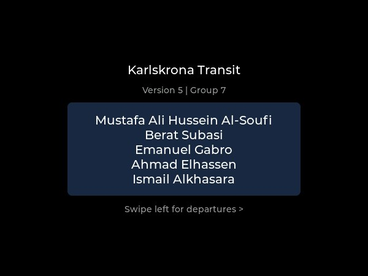
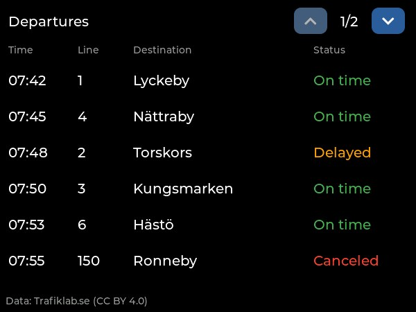
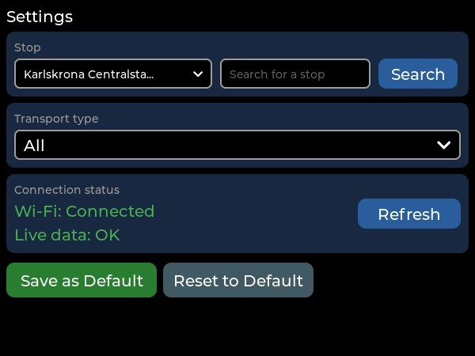
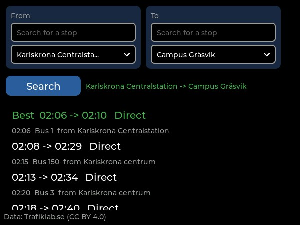
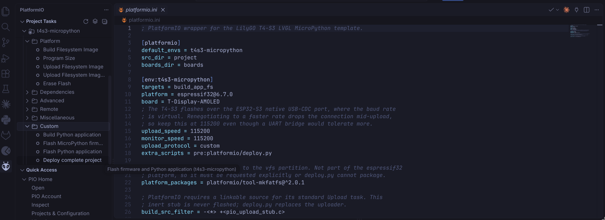

# Karlskrona Transit – PA1484 Group 7

## Introduction

Karlskrona Transit shows live public transport departures and plans journeys
in the Karlskrona region, on a LilyGO T4-S3 (ESP32-S3) with a 600×450 AMOLED
touchscreen. Instead of opening an app on a phone, you can glance at the
board to see when the next bus, train or ferry leaves from your stop, and
find the journey that gets you to your destination first.

Main functionality:

- A departure board with live data: time, line, destination and status (On
  time, Delayed or Canceled).
- Settings: search for any stop in the Karlskrona area, filter by transport
  type, save your choice as the default, and refresh by hand.
- Journey planning: search for a start and a destination stop, and see the
  journeys sorted by arrival time, with the best one marked.

Technologies: MicroPython and LVGL (included in the supplied firmware),
PlatformIO in Visual Studio Code, the
[Trafiklab Realtime API](https://www.trafiklab.se/sv/api/our-apis/trafiklab-realtime-apis/)
for departures and stops, and
[ResRobot v2.1](https://www.trafiklab.se/sv/api/our-apis/resrobot-v21/) for journeys.

**Group 7:** Mustafa Ali Hussein Al-Soufi, Berat Subasi, Emanuel Gabro, Ahmad
Elhassen and Ismail Alkhasara. See [Team and contributions](#team-and-contributions).

| | |
|---|---|
|  |  |
| Start screen: name, version, group and members | Departures with time, line, destination and status |
|  |  |
| Settings: stop search, transport type, connection status | Journey search with the best journey first |

## Getting started

### Prerequisites

- [Visual Studio Code](https://code.visualstudio.com/download) with the
  [PlatformIO IDE](https://marketplace.visualstudio.com/items?itemName=platformio.platformio-ide)
  extension. The first PlatformIO setup can take several minutes.
- A LilyGO T4-S3 board and a USB data cable.
- Python 3 to run the unit tests on your computer (we use 3.13). No extra
  packages are needed.
- Two free API keys from [Trafiklab](https://www.trafiklab.se/): one for the
  Trafiklab Realtime API and one for ResRobot v2.1.
- A Wi-Fi network. The T4-S3 cannot connect to eduroam: use another network or
  a phone hotspot.

### Installation

1. Clone the repository and open the folder in Visual Studio Code. If VS Code
   asks whether you trust the authors, answer "Yes, I trust the authors".
2. Copy `project/secrets_example.py` to `project/secrets.py`.
3. In `project/secrets.py`, fill in your Wi-Fi and your two API keys:

   ```python
   WIFI_SSID = "your network"
   WIFI_PASSWORD = "your password"
   TRAFIKLAB_API_KEY = "your Trafiklab Realtime key"
   RESROBOT_API_KEY = "your ResRobot key"
   ```

   Never commit `project/secrets.py`. It is listed in `.gitignore`.

**Linux only:** PlatformIO needs access to the serial port. Install the
PlatformIO udev rules once, then unplug and reconnect the board:

```bash
curl -fsSL https://raw.githubusercontent.com/platformio/platformio-core/develop/platformio/assets/system/99-platformio-udev.rules \
  | sudo tee /etc/udev/rules.d/99-platformio-udev.rules
sudo udevadm control --reload-rules
sudo udevadm trigger
```

If the port is still unreadable, add yourself to the group that owns it
(`dialout` on Debian/Ubuntu, `uucp` on Arch) and log in again:
`sudo usermod -aG dialout $USER`.

## Building and running

There is nothing to compile: the firmware already contains MicroPython and
LVGL, and the app is plain Python. Connect the board with USB, open the
PlatformIO tab and go to **Project Tasks > t4s3-micropython > Custom**:

- **Deploy complete project** – use this the first time, or when the board
  has no or other firmware. It flashes the firmware and the files in
  `project/` in one step. The Upload button runs the same task.
- **Flash Python application** – use this after code changes. It writes only
  the files in `project/`, so it is much faster.



### Start-up

The board starts `project/main.py`. The start screen is shown at once, while
the app connects to Wi-Fi in the background. The first departures are fetched
after 1.5 seconds, for your saved default stop or else Karlskrona
Centralstation. Start-up messages and errors are printed over USB at 115200
baud and stored in `/debug.log` on the board.

### Using the app

Swipe left and right to move between the four screens:

1. **Start screen** – project name, version, group number and members.
2. **Departures** – up to six departures per page. With more than six, the up
   and down arrows show page 1/2 and 2/2. The status is green (On time),
   orange (Delayed) or red (Canceled). The list updates every 60 seconds.
3. **Settings**
   - **Stop:** pick one of five fixed stops in the dropdown, or tap the search
     field, type a name with the on-screen keyboard (it has å, ä and ö) and
     press Enter or Search. The stops found open in the dropdown.
   - **Transport type:** All, Bus, Train or Ferry.
   - **Connection status:** Wi-Fi and live data status, and the **Refresh**
     button, which fetches the departures again at once.
   - **Save as Default** stores the stop and transport type on the board, so
     they are used after a restart. **Reset to Default** brings them back.
4. **Journeys** – pick or search for a stop in both From and To, and press
   Search. Up to five journeys are shown, sorted by arrival time. The journey
   that arrives first is marked "Best" in green. Each ride shows its departure
   time, line and stop, so you see the time at every change.

### Running the tests

The app's logic has unit tests that run on your computer, without the board.
Run them from the repository root:

```bash
python -m unittest tests/test_logic.py -v
```

The run should end with `OK`. See [docs/TESTING.md](docs/TESTING.md) for our
QA strategy, which tests cover each user story, and the manual test cases on
the device.

## Project structure

Our code is in `project/`, `tests/` and `docs/`. The other folders (`boards/`,
`firmware/`, `platformio/`, `support/`) are the BTH/LilyGO skeleton and are
not changed (NF4).

```
project/
├── main.py                  Starts the app: the four screens, timers and the link to the worker
├── screens/
│   ├── departure.py         Departure screen and the UI helpers all screens share (fonts, labels, buttons)
│   ├── settings.py          Settings screen, the on-screen keyboard and the saved defaults
│   └── journey.py           Journey screen: From/To search and the list of journeys
├── services/
│   ├── trafiklab.py         Trafiklab Realtime API and ResRobot: requests and a streaming JSON reader
│   └── departure_worker.py  Wi-Fi and all network requests in a background thread
├── secrets_example.py       Template for secrets.py (Wi-Fi and API keys)
└── pio_upload_stub.c        Skeleton file that PlatformIO needs; never flashed
tests/
└── test_logic.py            Unit tests, run on the PC with a fake LVGL and a fake API
docs/
└── TESTING.md               QA strategy, test coverage per user story and manual test cases
```

## Features

User stories from the project description (v5):

- [x] US1.1: As a user, I want to see a starting screen displaying the project
  name, current program version, group number, and members' names.
- [x] US1.2B: As a user, I want to see the departure screen showing departure
  data: departure time, line, destination, and departure status for any
  destinations in Karlskrona using live data from Trafiklab.
- [x] US2.1: As a user, I want to navigate between different screens by sliding
  a finger over the touchscreen.
- [x] US3.1: As a user, I want to access a settings screen.
- [x] US3.2C: As a user, I want to search and select different stops for US1.2B.
- [x] US3.3: As a user, I want to select a transport type (bus, train, ferry,
  and all) using a dropdown.
- [x] US3.4: As a user, I want to save my current settings as the default and
  have them restored when the device restarts.
- [x] US3.5: As a user, I want to reset my current settings to the stored
  default settings.
- [x] US4.1: As a user, I want the live departure data to update automatically
  in 60 seconds.
- [x] US4.2B: As a user, I want to manually refresh the departure data with a
  button in the settings screen.
- [x] US4.3: As a user, I want to see the current Wi-Fi connection and live
  data status on the settings screen.
- [x] US5.1: As a user, I want to access a journey selection screen.
- [x] US5.2B: As a user, I want to search for and select a starting stop and a
  final destination stop for US5.3.
- [x] US5.3B: As a user, I want to see the top matching journey, based on
  arrival time to the final destination, that shows the departure time for
  each intermediate stop where I must change transportation.

Non-functional requirements:

- [x] NF1 Coding standard: the code follows
  [PEP 8](https://peps.python.org/pep-0008/) with lines of at most 99
  characters: `snake_case` names, `CapWords` classes, `UPPER_CASE` constants
  at the top of each file, and imports in three groups (standard library,
  firmware modules, the skeleton's and our own). Check it with
  `python -m pip install pycodestyle`, then
  `python -m pycodestyle --max-line-length=99 project/main.py project/screens project/services tests`.
  No output means no errors. Do not reformat whole files with Black: it makes
  them bigger (see Known limitations).
- [x] NF2 Documentation: every module starts with a docstring that names its
  user stories, comments explain why the code does something, and this README
  and [docs/TESTING.md](docs/TESTING.md) document the project.
- [x] NF3 Trafiklab terms: the departure and journey screens show the
  attribution (see Data attribution below), and the API keys stay out of Git.
- [x] NF4 Skeleton unchanged: no skeleton file is changed. The app uses the
  skeleton's `start_board()` and its LVGL task handler as they are.
- [x] NF5 Quality assurance: automated unit tests on the PC, manual tests on
  the device, and traceability from each user story to its tests, described
  in [docs/TESTING.md](docs/TESTING.md).

## Known limitations

- **128 KB filesystem.** The deploy writes a 128 KB filesystem to the board,
  and every file takes whole 4 KB blocks. The app uses all of it. A new file
  or a few hundred extra bytes in a full file pushes the last skeleton files
  out of the image, and the board starts with a black screen. That is why the
  ResRobot code is in `trafiklab.py` and the saved settings are in
  `settings.py`: a file of their own would each cost at least 4 KB more.
- **Swipe speed.** We use the skeleton's display driver and LVGL task handler
  unchanged (NF4). With them, the board needs a long time to draw each frame
  of a swipe, so swiping between screens is slower and less smooth than on a
  phone.

## Troubleshooting

- **The screen is black.** Open PlatformIO Monitor and press RESET. Start-up
  errors are printed at 115200 baud and stored in `/debug.log`. Also check
  that `project/secrets.py` exists and that the files still fit in 128 KB.
- **Upload fails with "Invalid head of packet", or cannot connect.** Close
  PlatformIO Monitor. Then hold BOOT, tap RESET, release BOOT and start the
  upload at once. Press RESET when the upload is done. If the port is locked,
  reconnect the USB cable.
- **The screen shows the old interface and touch does nothing.** The board is
  still in upload mode: tap RESET once.
- **Upload stops at "Stub running... No serial data received".** Check that
  `upload_speed` in `platformio.ini` is still `115200`.

More about the board: [LilyGO AMOLED series](https://github.com/Xinyuan-LilyGO/LilyGo-AMOLED-Series).

## Team and contributions

In the beginning of the project, Mustafa made all the commits. No one else in
the group had used Git before, and Mustafa had experience with it. He worked
together with every member on their parts, so the commit history does not
show who did what. Later, the other members also committed their own work.

The real contribution of each member is shown on our
[Scrum board](https://github.com/users/mustafa-al-soufi/projects/1/views/2),
where every user story and task has its assignees.

## Data attribution

Departure, stop and journey data: **Data: Trafiklab.se (CC BY 4.0)**, from
[Trafiklab](https://www.trafiklab.se/) (Trafiklab Realtime API and ResRobot).
The same attribution is shown on the departure and journey screens.
